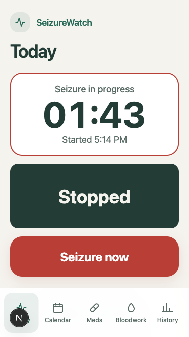
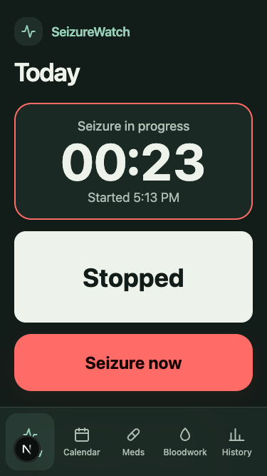
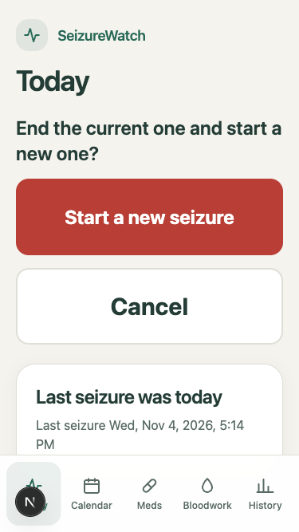
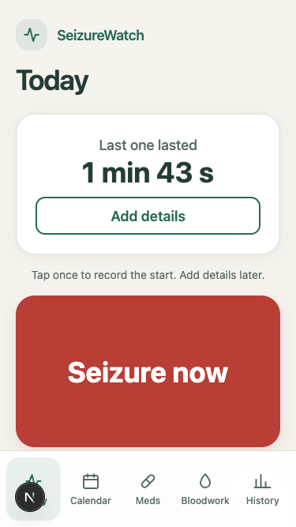
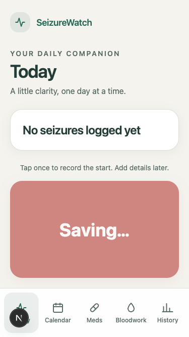
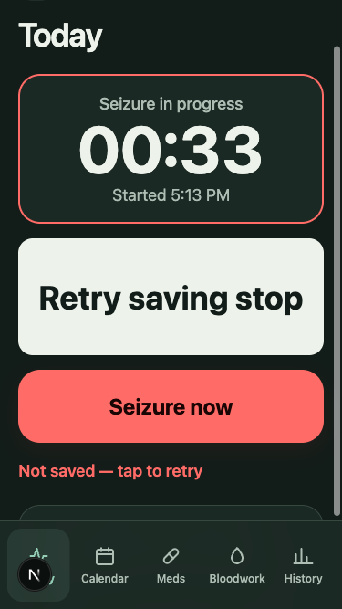

# V2.2 UI/UX review — 2026-11-04

Reviewed and refined by Codex, including its own visual changes. This closes the design review only, not the later Phase 2 code review or deployment.

## Findings resolved

- U1: Plain, inconsistent visual hierarchy. Added a warm neutral/green palette, branded header, cards, focus rings and selected-tab backgrounds; matched install colors and icons.
- U2: Primary action was high on the screen; historical content crowded active and confirmation controls. Idle summary precedes the start button; compact active, confirmation and completed states put controls first. At 375 × 667 the stop control occupies y=324–452, above navigation at y=570; Cancel occupies y=336–432.
- U3: “Today” did not explain what happened today. It now reads “Last seizure was today”.
- U4: Offline failure repeated identical text twice. Buttons now say “Retry saving start” or “Retry saving stop”, alongside one error message.
- U5: “Yes” lacked context in the new-seizure confirmation. It now says “Start a new seizure”.

## Verification

- Browser inspected at 390 × 844 and 375 × 667; all five tabs checked in light/dark without horizontal overflow in the first pass.
- Exercised actual development start/save, timer, stop/duration, confirmation and cancel; offline start/stop retries recovered successfully. Both temporary development records were removed by their exact IDs. Production was not modified.
- A delayed, aborted request verified the disabled Saving state. Retry labels and alerts were inspected after network failures.
- Existing seizure persistence tests: 36 passed. Lint, typecheck and production build passed after final source edits.
- The Add details destination belongs to pending V2.3; this review retains that existing link and does not claim the detail page is built.
- Browser emulation is not a physical iPhone ergonomics test. No deployment performed.

## Screenshots

